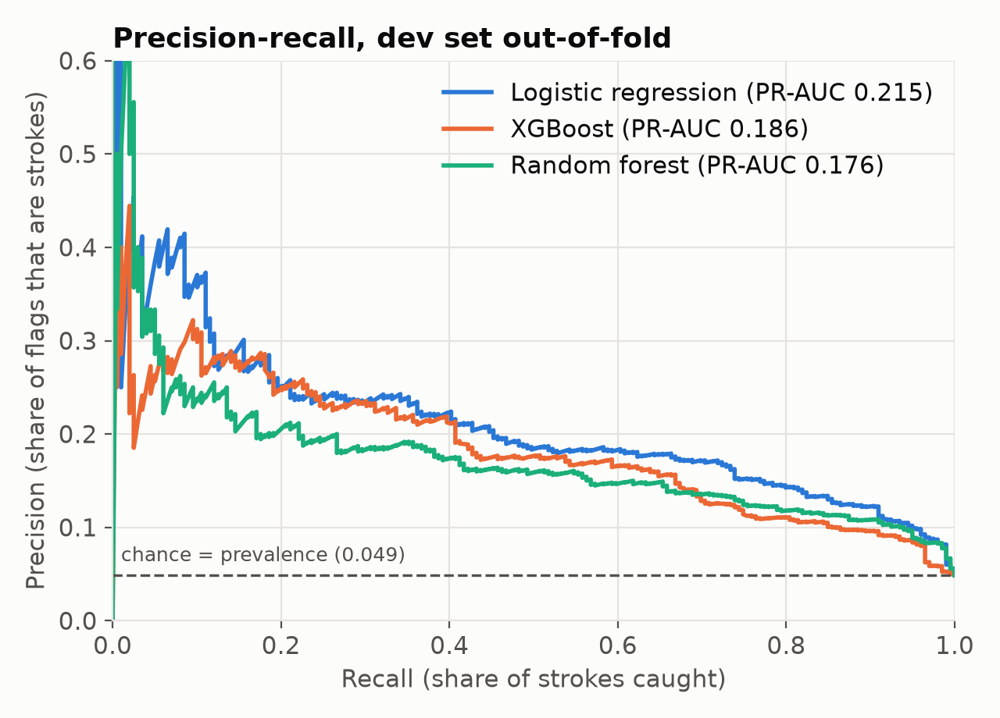
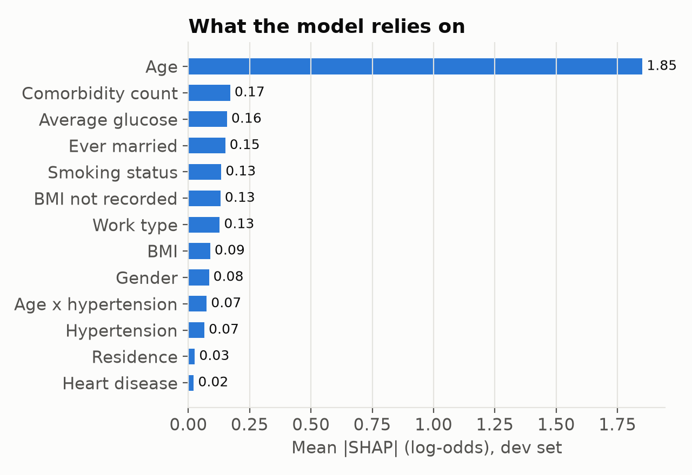
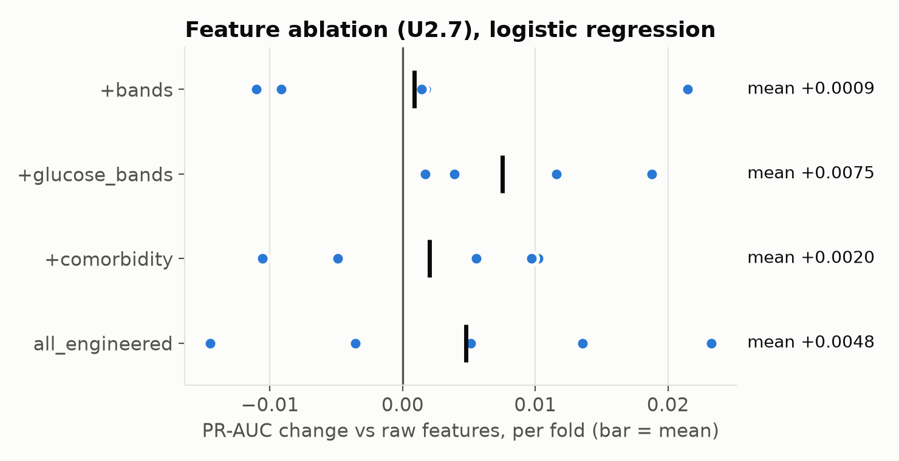
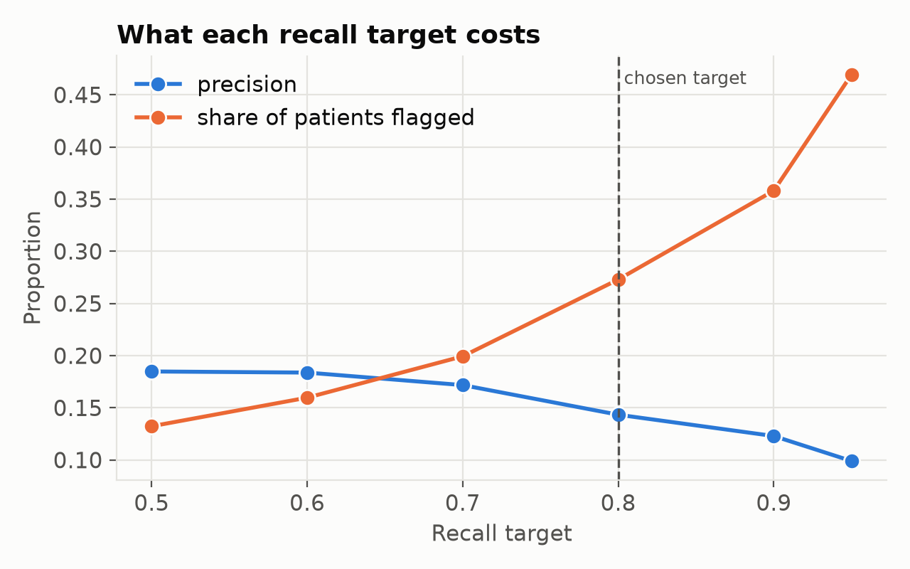

# StrokeWatch

A leakage-safe, explainable stroke-risk classifier built on tabular clinical risk factors, with a pre-registered model comparison, calibrated probabilities, per-patient SHAP explanations and a Streamlit research dashboard.

> **Research prototype, not a medical device.** This was built for CS F434 Data Science for Healthcare (BITS Pilani K K Birla Goa Campus) on a public, de-identified dataset with no external validation. Do not use it to make decisions about real people.

## Results

Evaluated **once** on a locked 20% holdout (1,022 patients, 50 strokes) after every modelling decision was frozen:

| Metric | Holdout (95% bootstrap CI) | Reference |
|---|---|---|
| PR-AUC (primary) | **0.257** (0.177–0.370) | chance = prevalence = 0.049 |
| ROC-AUC | 0.837 (0.776–0.887) | |
| Recall at pre-set threshold | 0.800 (0.680–0.900) | target 0.80, set on dev data |
| Precision at that threshold | 0.148 (0.125–0.170) | about 1 in 7 flags is a stroke |
| Brier score (calibrated) | 0.042 (0.039–0.044) | 0.047 for always predicting prevalence |

What came out of it:

- **The simple model won.** Tuned XGBoost (60-config search) and random forest both scored *lower* PR-AUC than class-weighted logistic regression, and neither passed the adoption rule fixed before any results: *"adopt only if the PR-AUC gain CI excludes 0 and calibration is not worse."*
- **Feature engineering added little.** A paired ablation on the same 5 folds found at most +0.0075 PR-AUC from engineered features (glucose bands). Fold-to-fold noise is about 0.044. The features stay in because they make explanations readable, not because they improve accuracy.
- **Age dominates.** SHAP puts age at roughly 10× any other input. Correlated inputs share credit, and proxies such as marital status track age, so the app shows a non-causal caveat next to every explanation.

Full tables: [`reports/results.md`](reports/results.md). Figures: [`reports/figures/`](reports/figures/).

| | |
|---|---|
|  |  |
|  |  |

## How it works

```
raw CSV ──► M1 CleanTransformer ──► M2 feature transformer ──► classifier ──► Platt calibration ──► threshold
            (BMI median + missing     (one-hot, scaling, age/BMI/     (LR / XGBoost /    (fit on dev          (80% recall on
             indicator, fit in-fold)    glucose bands, comorbidity)    random forest)     out-of-fold)         dev out-of-fold)
                                                                                    └──► SHAP top-5 per record ──► Streamlit app
```

- **No leakage by construction.** Cleaning, features and model form one scikit-learn `Pipeline`, so imputation and scaling are re-fit inside every outer training fold *and* every inner tuning split.
- **Holdout locked in code.** `dataset.holdout_frame()` raises unless called with `unlock=True`, and only the final step of `train.py` does that. Every fit asserts that no holdout id is present.
- **Fair comparison.** Every model uses the same 5 frozen stratified folds, the same metric library (`evaluate.py`, which deliberately has no accuracy function) and a patient-level paired bootstrap for model-vs-model CIs.
- **Honest probabilities.** Class weighting inflates scores, so a Platt calibrator fit on out-of-fold predictions maps them back. A raw score of 0.85 meant about a 21% observed stroke rate before calibration.
- **Explanations that add up.** Exact linear SHAP values are summed from one-hot columns back to source variables, and an additivity test checks that base value + contributions = the model's log-odds.

Details: [`docs/evaluation_protocol.md`](docs/evaluation_protocol.md), [`docs/model_card.md`](docs/model_card.md), [`docs/limitations.md`](docs/limitations.md), [`feature_dictionary.md`](feature_dictionary.md), [`docs/PROJECT_GUIDE.md`](docs/PROJECT_GUIDE.md).

## Run it

The dataset is not redistributed here (see [`m1_jyot/LICENCE_NOTE.md`](m1_jyot/LICENCE_NOTE.md)). Download `healthcare-dataset-stroke-data.csv` from [Kaggle (fedesoriano/stroke-prediction-dataset)](https://www.kaggle.com/datasets/fedesoriano/stroke-prediction-dataset) into `m1_jyot/`, then:

```bash
make setup     # python3 -m venv .venv && pip install -r requirements.txt
make data      # checks the SHA-256, rebuilds the typed table and frozen splits
make train     # ablation, 3 tuned models, adoption rule, one holdout evaluation (~7 min)
make explain   # SHAP global importance
make docs      # feature dictionary from the fitted model
make test      # 36 tests
make app       # Streamlit dashboard at http://localhost:8501
```

Exact versions used are in `requirements-lock.txt` (Python 3.14, scikit-learn 1.9, XGBoost 3.4, SHAP 0.54, pandas 3.1). Seeds are fixed at 42.

## Repository map

| Path | What it is |
|---|---|
| `m1_jyot/`, `upstream_preprocess.py` | M1: typing, anomaly flags, `CleanTransformer`, frozen splits |
| `features.py` | M2: feature transformer with switchable derived groups |
| `dataset.py` | Frozen-split access and the holdout lock |
| `evaluate.py` | Shared metrics, bootstrap CIs, threshold policy, paired deltas |
| `models.py` | Pipelines, search spaces, calibration, the `StrokeModel` wrapper |
| `train.py`, `report.py` | The end-to-end experiment and its report |
| `explain.py` | SHAP explainer, grouping to source variables |
| `app/` | Streamlit dashboard and upload validation |
| `tests/` | Leakage, protocol, metric and app tests |

## Team

Group 8, CS F434 (2026): **Jyot** (data engineering, dashboard), **Chirantan** (feature engineering, SHAP explainability), **Arth** (evaluation protocol, baseline and advanced models). Dhruv and Aaditya contributed to the Part 1 plan.

## Limitations

The data is a single Kaggle dataset of undisclosed provenance and the labels are cross-sectional ("has had a stroke", not "will have one"). Key clinical variables are missing, there's no external validation, and precision is low at ~5% prevalence. See [`docs/limitations.md`](docs/limitations.md).
